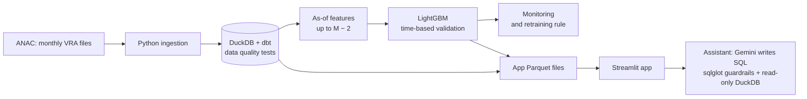

# Flight Delay Radar

[](https://github.com/EduardoHenrique15/flight-delay-radar/actions/workflows/ci.yml)
[](https://flight-delay-radar.streamlit.app)

[Português](README.md) · **English**

How much domestic flights in Brazil are delayed, where and when, and the chance that a future
flight departs more than 15 minutes late. An end-to-end data project on public data from ANAC
(Brazil's civil aviation agency): ingestion, a warehouse with data quality tests, a model always
validated on future data, monthly monitoring with a retraining rule, and an assistant that
answers questions in SQL.

**[Open the app](https://flight-delay-radar.streamlit.app)** (the interface is in Portuguese)


## What the app shows

| Page | What it has |
| --- | --- |
| Visão geral (Overview) | Last month's numbers, a departures board with the model's predicted chance of delay and a clickable map: pick an airport to see where its flights are most delayed. |
| Pontualidade (On-time performance) | Filters by period, airline and route; airline ranking, monthly trend and a day-of-week by hour heatmap. |
| Previsão (Prediction) | Pick route, airline, date and hour: the chance of delay on a boarding pass, the factors that weighed most (SHAP), other airlines and other hours. |
| Buscar voo (Flight lookup) | Type a flight number (e.g. G3 1400): how often it left on time in the last 12 months, how large the delays were, month by month, and the predicted chance for the next flight. |
| Monitoramento (Monitoring) | Month-by-month performance against the baseline, calibration, feature drift (PSI) and the retraining timeline. |
| Pergunte aos dados (Ask the data) | Questions in Portuguese become SQL, which goes through guardrails and runs on the app's database. |
| Sobre o modelo (About the model) | How the prediction works, test metrics with intervals and the limitations. |

<table>
<tr>
<td></td>
<td></td>
</tr>
</table>

## Results

Test set from Jun to Aug 2026 (196,159 flights), used only once, after every choice was locked.
The baseline is the route's historical delay rate at that hour. 95% intervals from a bootstrap
paired by day. Numbers come from [`models/metrics.json`](models/metrics.json).

| Metric | LightGBM (95% CI) | Baseline | Gain (95% CI) |
| --- | --- | --- | --- |
| PR-AUC | 0.312 (0.291 to 0.333) | 0.282 | +0.029 (+0.019 to +0.041) |
| ROC-AUC | 0.696 (0.685 to 0.705) | 0.674 | +0.022 (+0.015 to +0.029) |
| Brier (lower is better) | 0.1238 | 0.1260 | −0.0021 (−0.0029 to −0.0014) |

- Among the 10% of flights with the highest predicted risk, **37.3% were delayed** (2.35 times
  the average). With the baseline, 33.6%.
- Calibration: mean error (ECE) of 1.24 p.p. between predicted chance and actual rate.
- In monitoring (Dec 2025 to Aug 2026, a simulation that never looks ahead), the model beat the
  baseline in **9 of 9 months**; one retrained challenger was promoted in Jun 2026.

The gain over the baseline is small but consistent: the route's history at that hour already
explains much of the delay. Details, segments and errors in the
[model card](docs/modelo.md) (Portuguese).

## How it works



- **Data:** ANAC's Voo Regular Ativo (VRA), Jan 2022 to Aug 2026. Model base: 3,478,254 completed
  domestic scheduled flights, 14.95% delayed more than 15 minutes
  ([data notes](docs/dados.md), Portuguese).
- **No leakage:** every feature uses only the history published up to 2 months before the
  flight, as in real life; `tests/test_no_leakage.py` checks it. The app computes features for a
  future flight with the same SQL query used in training.
- **Model selection:** 5 time-based validation windows; baseline, logistic regression and
  LightGBM, with the one-standard-error rule.
- **Monthly update:** a GitHub Actions workflow downloads the new month, runs the pipeline and
  monitoring, and opens a pull request with the data and metrics.
- **Assistant:** Gemini only writes the query, from a description of the tables. The SQL goes
  through two layers of guardrails (SELECT only, only the app's 6 tables, no files or network,
  up to 1,000 rows and 10 seconds), and the answer's numbers always come from the database.

Decisions are recorded as [ADRs](docs/decisoes/README.md) (Portuguese): data window, target,
leakage rule, warehouse, model selection, retraining rule, text-to-SQL and deployment without a
separate API.

## Limitations

- VRA has no weather data, one of the main causes of delay.
- No aircraft rotation: the delay of the same aircraft's previous flight is not used.
- The model underestimates risk in the highest bands and errs more for small airlines.
- It is a probability, not a guarantee; it is not meant for compensation claims or for ranking
  airline quality.

## Running it

Requires Python 3.11.

```bash
python -m venv .venv
source .venv/bin/activate           # Windows: .venv\Scripts\Activate.ps1
pip install -r requirements-dev.txt
pip install -e .
pytest                              # tests on a data sample, never calls Gemini
streamlit run app/streamlit_app.py  # the app reads the Parquet files in data/marts/
```

Without a Gemini key, the assistant runs in demo mode. The full pipeline (VRA download, dbt,
training and monitoring) and deployment are in [docs/deploy.md](docs/deploy.md) (Portuguese).

## Repository layout

```text
app/          Streamlit app (one page per file in app/paginas/)
src/fdr/      ingestion, features, model, monitoring, assistant and UI
dbt/          warehouse models and data quality tests
data/marts/   app data (Parquet), versioned
models/       trained model, metrics and explanations
monitoring/   month-by-month monitoring history
eval/         assistant evaluation questions
docs/         model card, data notes, deployment and ADRs
tests/        tests (pytest), run in CI on every push
```

## Author

Eduardo Henrique de Sá · [LinkedIn](https://www.linkedin.com/in/eduardo-henrique15/) · [GitHub](https://github.com/EduardoHenrique15)

Open to roles in Data Science, Machine Learning and AI.

MIT License. Data from ANAC (open data) and OurAirports.
