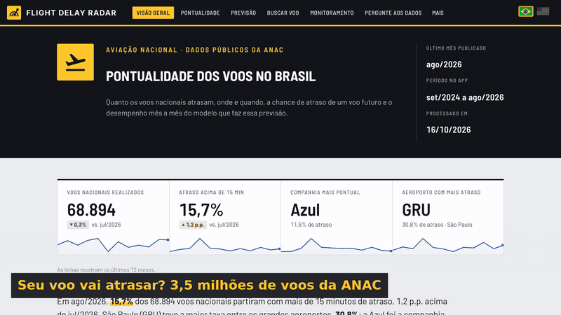
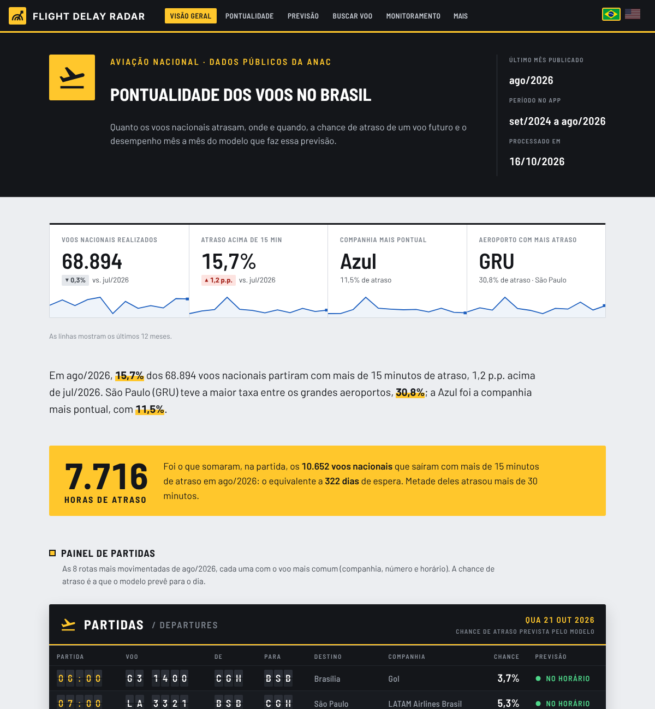
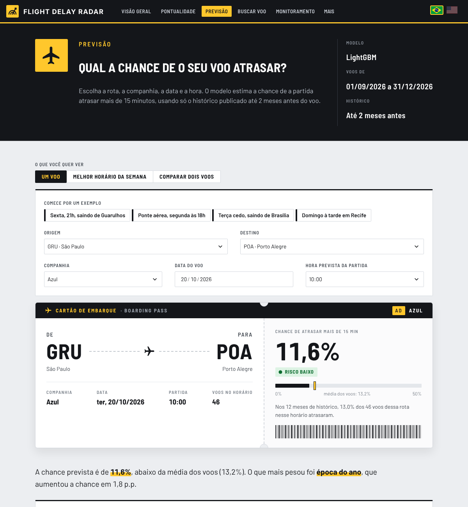
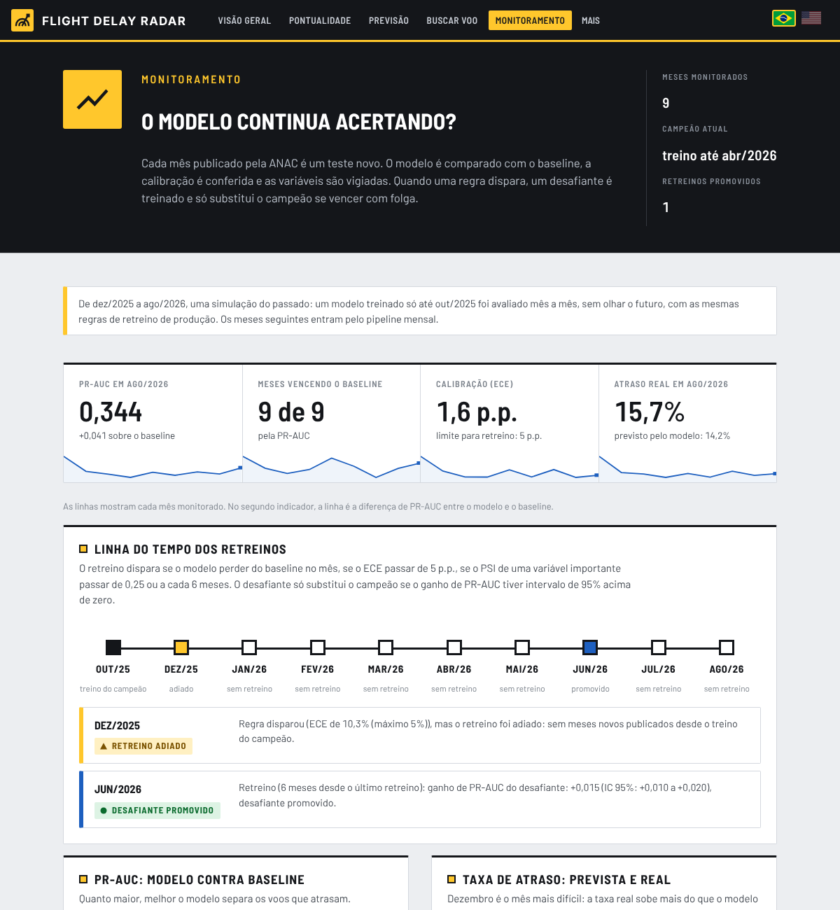
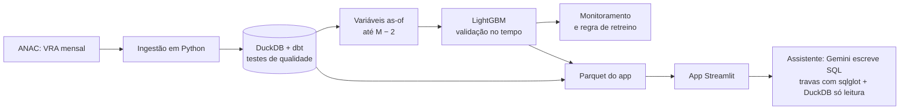

# Flight Delay Radar

[](https://github.com/EduardoHenrique15/flight-delay-radar/actions/workflows/ci.yml)
[](https://flight-delay-radar.streamlit.app)

**Português** · [English](README.en.md)

Quanto os voos nacionais atrasam, onde e quando, e qual a chance de um voo futuro partir com mais
de 15 minutos de atraso. Um projeto de dados de ponta a ponta com os dados públicos da ANAC:
ingestão, warehouse com testes de qualidade, um modelo validado sempre no futuro, monitoramento
mês a mês com regra de retreino e um assistente que responde perguntas em SQL.

**[Abrir o app](https://flight-delay-radar.streamlit.app)** (em português ou inglês: botão PT | EN no topo)



## O que o app mostra

| Página | O que tem |
| --- | --- |
| Visão geral | Os números do último mês, um painel de partidas com a chance prevista pelo modelo e um mapa clicável: escolha um aeroporto para ver para onde os voos dele mais atrasam. |
| Pontualidade | Filtros de período, companhia e rota; ranking das companhias, evolução mensal e o mapa de calor de dia da semana e hora. |
| Previsão | Escolha rota, companhia, data e hora: a chance de atraso num cartão de embarque, os fatores que mais pesaram (SHAP), as outras companhias e os outros horários. |
| Buscar voo | Digite o número do voo (ex.: G3 1400): quantas vezes ele saiu no horário nos últimos 12 meses, o tamanho dos atrasos, mês a mês, e a chance prevista para o próximo voo. |
| Monitoramento | Desempenho mês a mês contra o baseline, calibração, mudança nas variáveis (PSI) e a linha do tempo dos retreinos. |
| Pergunte aos dados | Perguntas em português ou inglês viram SQL, que passa por travas e roda no banco do app. |
| Sobre o modelo | Como a previsão é feita, as métricas do teste com intervalos, onde o modelo erra (por companhia, aeroporto, horário e mês), quantos atrasos uma regra de alerta pega e as limitações. |

<table>
<tr>
<td></td>
<td></td>
<td></td>
</tr>
</table>

## Resultados

Teste de jun a ago/2026 (196.159 voos), usado uma única vez, depois de todas as escolhas. O
baseline é a taxa histórica de atraso da rota naquele horário. Intervalos de 95% por bootstrap
pareado por dia. Os números vêm de [`models/metrics.json`](models/metrics.json).

| Métrica | LightGBM (IC 95%) | Baseline | Ganho (IC 95%) |
| --- | --- | --- | --- |
| PR-AUC | 0,312 (0,291 a 0,333) | 0,282 | +0,029 (+0,019 a +0,041) |
| ROC-AUC | 0,696 (0,685 a 0,705) | 0,674 | +0,022 (+0,015 a +0,029) |
| Brier (menor é melhor) | 0,1238 | 0,1260 | −0,0021 (−0,0029 a −0,0014) |

- Dos 10% de voos com maior risco previsto, **37,3% atrasaram** (2,35 vezes a média). Com o
  baseline, foram 33,6%.
- Calibração: erro médio (ECE) de 1,24 p.p. entre a chance prevista e a taxa real.
- No monitoramento (dez/2025 a ago/2026, simulação sem olhar o futuro), o modelo venceu o
  baseline em **9 de 9 meses**; um retreino foi promovido em jun/2026.

O ganho sobre o baseline é pequeno, mas consistente: o histórico da rota no horário já explica
boa parte do atraso. Detalhes, segmentos e erros no [cartão do modelo](docs/modelo.md).

## Como funciona



- **Dados:** Voo Regular Ativo (VRA) da ANAC, jan/2022 a ago/2026. Base do modelo: 3.478.254
  voos nacionais regulares realizados, 14,95% com atraso acima de 15 minutos
  ([como os dados foram tratados](docs/dados.md)).
- **Sem vazamento:** cada variável usa só o histórico publicado até 2 meses antes do voo, como na
  vida real; `tests/test_no_leakage.py` prova isso. O app calcula as variáveis de um voo futuro
  com a mesma consulta SQL do treino.
- **Escolha do modelo:** 5 janelas de validação no tempo, baseline, regressão logística e
  LightGBM, com a regra de 1 erro-padrão.
- **Atualização mensal:** um workflow do GitHub Actions baixa o mês novo, roda o pipeline e o
  monitoramento e abre um pull request com os dados e as métricas.
- **Assistente:** o Gemini só escreve a consulta, a partir da descrição das tabelas. O SQL passa
  por duas camadas de travas (só SELECT, só as 6 tabelas do app, sem arquivos nem rede, até
  1.000 linhas e 10 segundos), e o número da resposta sempre vem do banco. Na avaliação com
  31 perguntas de resposta conhecida, acertou 27 de 31 (87,1%) pelo critério automático e
  30 de 31 na revisão manual ([como funciona e como foi avaliado](docs/assistente.md)).

As decisões estão registradas em [ADRs](docs/decisoes/README.md): janela de dados, alvo, regra
contra vazamento, warehouse, escolha do modelo, regra de retreino, texto para SQL e a publicação
sem API separada.

## Limitações

- O VRA não traz o clima, uma das maiores causas de atraso.
- Não há a rotação do avião: o atraso do voo anterior da mesma aeronave não entra.
- O modelo subestima o risco nas faixas mais altas e erra mais nas companhias pequenas.
- É uma probabilidade, não uma garantia; não serve para pedir indenização nem para ranquear a
  qualidade das companhias.

## Como rodar

Requer Python 3.11.

```powershell
python -m venv .venv
.venv\Scripts\Activate.ps1          # no Linux/macOS: source .venv/bin/activate
pip install -r requirements-dev.txt
pip install -e .
pytest                              # testes com uma amostra dos dados, sem chamar o Gemini
streamlit run app/streamlit_app.py  # o app usa os Parquet de data/marts/
```

Sem a chave do Gemini, o assistente fica em modo de demonstração. O pipeline completo (download
do VRA, dbt, treino e monitoramento) e a publicação estão em [docs/deploy.md](docs/deploy.md).

## Estrutura

```text
app/          app Streamlit (uma página por arquivo em app/paginas/)
src/fdr/      ingestão, variáveis, modelo, monitoramento, assistente e interface
dbt/          modelos e testes de qualidade do warehouse
data/marts/   dados do app (Parquet), versionados
models/       modelo treinado, métricas e explicações
monitoring/   histórico mês a mês do monitoramento
eval/         perguntas de avaliação do assistente
docs/         cartão do modelo, dados, publicação e ADRs
tests/        testes (pytest), rodados no CI a cada push
```

## Autor

Eduardo Henrique de Sá · [LinkedIn](https://www.linkedin.com/in/eduardo-henrique15/) · [GitHub](https://github.com/EduardoHenrique15)

Aberto a vagas em Ciência de Dados, Machine Learning e IA.

Licença MIT. Os dados são da ANAC (dados abertos) e do OurAirports.
