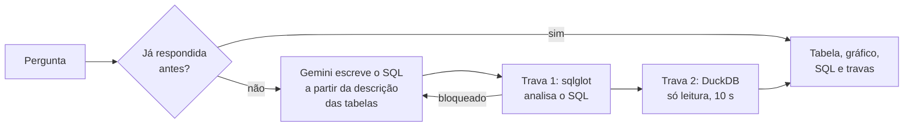

# Assistente: perguntas em português, respostas do banco

A página "Pergunte aos dados" transforma uma pergunta sobre os voos numa consulta SQL, roda a
consulta nos dados do app e mostra a resposta junto com a tabela, um gráfico (quando a tabela
pede), o SQL e as travas que ele cumpriu. A decisão de usar texto para SQL, e não um modelo que
responde sozinho, está no [ADR 007](decisoes/007-texto-para-sql-com-travas.md).

Os números deste documento vêm de `eval/results/` e de `eval/revisao.yaml`;
`tests/test_avaliacao_e_grafico.py` confere que eles batem.

## 1. Como uma pergunta vira resposta



- **O modelo não vê os dados.** O Gemini recebe só a descrição das 6 tabelas do app (`voos`,
  `pontualidade_mensal`, `atraso_rota_hora`, `aeroportos`, `companhias` e `rotas`, em
  `src/fdr/assistant/schema.py`), com as convenções do projeto (código ICAO, taxa de atraso =
  atrasados_15 / realizados_com_horario). Ele devolve um JSON com o SQL e uma explicação curta, ou
  diz que os dados não respondem a pergunta.
- **O número vem sempre do banco.** O texto da resposta é a explicação do modelo mais uma frase
  montada a partir da tabela ("Resposta: 15,7%."). O modelo nunca escreve o número.
- **Uma nova tentativa.** Se o SQL for bloqueado ou der erro, o erro volta para o modelo uma vez.
- **Cache.** Uma pergunta já respondida (a mesma, sem diferença de maiúsculas e acentos) reusa o
  SQL aprovado, que roda de novo nos dados atuais. Perguntas em inglês têm um cache à parte.
- **Limites.** No app, cada visita pode fazer 3 perguntas novas, e o app inteiro, 6 por dia (a
  cota gratuita do Gemini é pequena). Depois disso, só as perguntas de exemplo respondem. Se o
  Gemini avisar que a cota do dia acabou (erro 429), o app marca o dia, para de pedir e passa ao
  modo de demonstração, em vez de mostrar o erro.
- **Modo de demonstração.** Sem a chave do Gemini, ou sem cota, as perguntas de exemplo usam as
  respostas gravadas em `data/demo/assistant_cache.json`: as perguntas marcadas com `demo` em
  `eval/questions.yaml` que o modelo acertou na avaliação (`python -m fdr.assistant.eval --demo`).
- **Inglês.** No app em inglês, o modelo escreve a explicação em inglês; as mensagens fixas e as
  respostas de demonstração têm tradução (`src/fdr/traducoes/assistente.py`).

## 2. As travas

Duas camadas independentes (`src/fdr/assistant/guard.py`). A segunda segura o que passar pela
primeira.

| Camada | O que garante |
| --- | --- |
| 1. Análise do SQL (sqlglot), antes de rodar | Uma instrução só, de leitura (SELECT ou WITH ... SELECT); só as 6 tabelas do app, pelo nome; nenhuma função de arquivo, rede ou sistema (`read_csv`, `glob`, `getenv`...); nada de ATTACH, COPY, INSTALL, LOAD, PRAGMA ou SET; LIMIT de no máximo 1.000 linhas (acrescentado quando falta). |
| 2. A conexão (DuckDB) | Banco aberto só para leitura, sem acesso externo (`enable_external_access = false`), configuração travada e tempo máximo de 10 segundos por consulta. |

Os testes das travas (`tests/test_assistant.py`) tentam 24 consultas maliciosas, entre elas
apagar tabelas, ler arquivos do disco e URLs, ler a chave do Gemini com `getenv`, empilhar duas
instruções e mudar a configuração; todas são bloqueadas.

## 3. O gráfico automático

`src/fdr/assistant/visual.py` olha a tabela e escolhe, por uma regra fixa (sem o modelo):

- **linha:** uma coluna de mês ou data e uma numérica, com pelo menos 3 linhas;
- **barras:** uma coluna de rótulos (companhia, aeroporto, cidade, hora, rota) e uma numérica,
  de 2 a 15 linhas;
- **nenhum:** um número só, tabelas sem coluna numérica ou grandes demais.

Quando há uma taxa, ela é a medida (e vira porcentagem); senão, a última coluna numérica.

## 4. Avaliação

**Método.** 31 perguntas com resposta conhecida (`eval/questions.yaml`), em 5 tipos: simples,
somas e rankings, junções, no tempo e recusas (perguntas que os dados não respondem). Cada
pergunta tem um SQL de referência escrito à mão. A métrica principal é o **acerto por
execução**: o resultado do SQL do modelo precisa ter o mesmo número de linhas e, para cada coluna
da referência, uma coluna com os mesmos valores (com tolerância numérica e sem considerar a ordem
das linhas). Nas recusas, o certo é recusar. As perguntas foram feitas sem cache e sem os limites
do app, em 3 lotes, porque a cota gratuita do Gemini limita os pedidos por dia.

**Resultado** (gemini-3.8-flash, de 17/10/2026 a 19/10/2026):

| Métrica | Resultado |
| --- | --- |
| Acerto automático (a métrica principal) | **27 de 31 (87,1%)** |
| Na revisão manual (mesmos números, outra forma) | 30 de 31 |
| SQL válido, nas perguntas respondíveis | 28 de 28 |
| Consultas bloqueadas pelas travas ou com erro | 0 |
| Recusas certas | 3 de 3 |
| Perguntas que precisaram de nova tentativa | 0 |

| Tipo de pergunta | Acerto automático |
| --- | --- |
| Simples | 9 de 10 |
| Somas e rankings | 5 de 8 |
| Junções | 5 de 5 |
| No tempo | 5 de 5 |
| Recusas | 3 de 3 |

**Revisão manual das erradas** (`eval/revisao.yaml`). Rodei o SQL gerado e o de referência nos
dados do app e comparei:

| Pergunta | Veredito | O que aconteceu |
| --- | --- | --- |
| 7 | Erro de verdade | "Qual é o código ICAO da Gol?": buscou os nomes que contêm "Gol" (ILIKE) e trouxe também a Cargolux e a TAAG Angola Airlines. |
| 12 | Mesmos números | Os 5 aeroportos com mais cancelamentos, na mesma ordem e com os mesmos totais, pelo nome em vez do código ICAO. |
| 13 | Mesmos números | A hora com a maior taxa de atraso (22h) no topo, mas listando as 5 primeiras em vez de uma. |
| 16 | Mesmos números | As 5 companhias com mais atrasos acima de 1 hora, na mesma ordem e com os mesmos totais, pelo nome em vez do código. |

A métrica automática continua sendo a principal: o comparador e as referências não mudaram
depois de ver os resultados. A revisão só mostra quais erros mudam a resposta.

**Tempo de resposta.** A mediana por pergunta na avaliação foi de 28 s, mas ela inclui as esperas
pelo limite por minuto do plano gratuito do Gemini (a avaliação espera e tenta de novo). Não é o
tempo de uma pergunta isolada no app.

## 5. Limitações

- **31 perguntas é pouco.** O resultado mostra o comportamento típico, não garante cada pergunta.
- **Um modelo só, sem repetição.** Com temperatura 0 o modelo é quase determinístico, mas uma
  versão nova do Gemini pode mudar os resultados; a avaliação precisa ser refeita.
- **Ambiguidade.** Nomes parecidos (o erro da pergunta 7) e perguntas que pedem "a hora" mas
  aceitam um ranking são os pontos fracos. A tabela e o SQL aparecem sempre, para conferir.
- **Só os dados do app.** Preço de passagem, clima, tripulação e o motivo do atraso não estão nas
  tabelas: o assistente recusa.

## 6. Como rodar

```powershell
python -m fdr.assistant.eval --referencia    # confere os SQLs de referência (sem o Gemini)
python -m fdr.assistant.eval --lote 1        # perguntas 1 a 11 (precisa de GEMINI_API_KEY)
python -m fdr.assistant.eval --lote 2        # perguntas 12 a 22
python -m fdr.assistant.eval --lote 3        # perguntas 23 a 31
python -m fdr.assistant.eval --demo          # grava as respostas de demonstração
```

A chave do Gemini fica no `.env` (local) ou nos Secrets do Streamlit (publicação), nunca no
código. Os testes usam um modelo falso e nunca chamam o Gemini.
