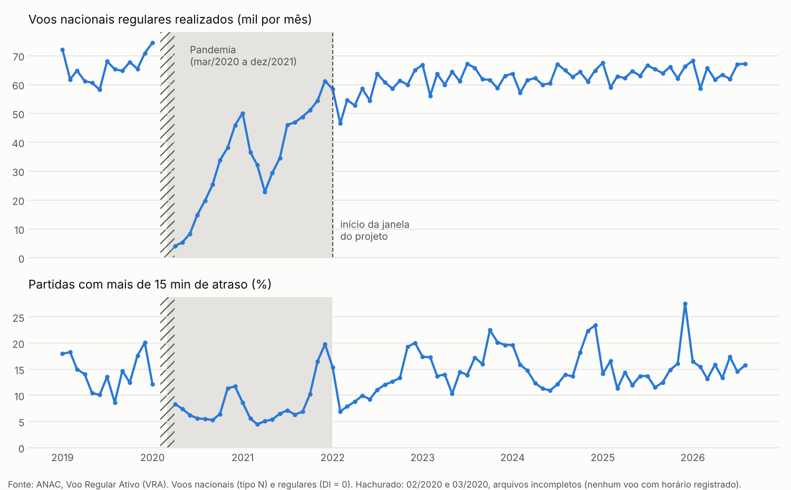

# ADR 001: janela de dados a partir de janeiro de 2022

- **Situação:** aceita
- **Data:** 11/10/2026
- **Dados:** [`dados/volume_mensal.csv`](dados/volume_mensal.csv), gerado por
  `scripts/volume_mensal.py` a partir dos arquivos do VRA de jan/2019 a ago/2026.

## Contexto

O modelo aprende com o histórico de atrasos. Se o histórico tiver um período em que a aviação
funcionou de um jeito muito diferente do normal, o modelo aprende padrões que não se repetem.
A especificação inicial do projeto (documento de planejamento, não publicado) propôs começar em janeiro de 2022 por causa da
pandemia. Este ADR confere a proposta com os dados.

O que os dados mostram (voos nacionais regulares realizados, tipo `N` e DI = `0`):

| Período | Voos por mês (média) | Partidas com mais de 15 min de atraso (média mensal) |
| --- | --- | --- |
| 2019 | 65,1 mil | 14,4% |
| 2020 (10 meses com dados) | 27,0 mil | 8,0% |
| 2021 | 42,9 mil | 8,5% |
| 2022 | 57,9 mil | 12,2% |
| 2023 | 62,5 mil | 16,4% |
| 2024 | 62,5 mil | 15,7% |
| 2025 | 64,1 mil | 14,9% |

- **Abril de 2020** teve 4.065 voos, 6,6% de abril de 2019.
- De **abril de 2020 a outubro de 2021**, a taxa de atraso ficou entre 4,5% e 11,7%, bem abaixo do
  normal. Com poucos voos, aeroportos e malha aérea ficam folgados, e o atraso cai. É outro regime
  de operação. Só em novembro e dezembro de 2021, com o volume já perto do normal, ela voltou a
  16,5% e 19,8%.
- A recuperação foi gradual: **dezembro de 2021** já teve 86% do volume de dezembro de 2019.
- **O começo de 2022 ainda carrega efeitos da pandemia** (onda Ômicron): fevereiro de 2022 teve 75%
  do volume de fevereiro de 2019, e de fevereiro a abril a taxa de atraso ficou entre 6,9% e 8,8%.
  De maio de 2022 em diante, o volume mensal fica entre 88% e 108% do mesmo mês de 2019.
- **Fevereiro e março de 2020 vieram com arquivos incompletos:** 19,5 mil e 15,4 mil linhas
  (janeiro de 2020 teve 92,4 mil, e fevereiro de 2019, 79,5 mil) e nenhum voo com partida real
  registrada. Fevereiro ainda era antes da pandemia no Brasil, então é falha do arquivo, e não
  queda real de voos. No gráfico, esses dois meses aparecem hachurados.

## Decisão

A janela de dados do projeto começa em **janeiro de 2022**, como na especificação. Os anos de
2020 e 2021 ficam fora: lá o volume e a taxa de atraso mostram um regime de operação diferente do
que o modelo vai encontrar.

## Alternativas consideradas

1. **Começar em 2019 e pular 2020 e 2021.** Daria mais um ano de dados, mas abriria um buraco de dois
   anos no histórico. As variáveis históricas (taxa de atraso da rota nos últimos 3 e 12 meses)
   ficariam sem base logo depois do buraco. Além disso, a malha aérea de 2019 era outra.
2. **Incluir 2020 e 2021 com uma variável "pandemia".** O modelo teria que aprender um regime que
   não deve voltar, com volume entre 7% e 87% do normal. Isso aumenta a complexidade sem ganho
   para a pergunta do projeto, que é prever atrasos de agora em diante.
3. **Começar em maio de 2022**, quando o volume volta ao nível de 2019. Evitaria os meses
   ainda afetados do começo de 2022, mas perderia esse histórico para as variáveis de 12 meses.

## Consequências

- O pipeline baixa e carrega dados a partir de janeiro de 2022 (`INICIO_JANELA` em
  `src/fdr/config.py`). Os arquivos de 2019 a 2021 foram usados só para este ADR e não ficam no
  projeto.
- **Proposta para o ADR 003 (regra contra vazamento):** as variáveis históricas usam janelas de até
  12 meses, então só a partir de janeiro de 2023 um voo tem 12 meses completos de histórico. A
  proposta é usar 2022 só como histórico e começar os exemplos de treino em janeiro de 2023. Isso
  também deixa de fora do treino os meses de fevereiro a abril de 2022, ainda afetados pela
  pandemia.
- A taxa de atraso varia bastante entre meses dentro da janela: de 6,9% (fevereiro de 2022) a
  27,6% (dezembro de 2025). O monitoramento mensal (Fase 4) precisa contar com essa variação.
