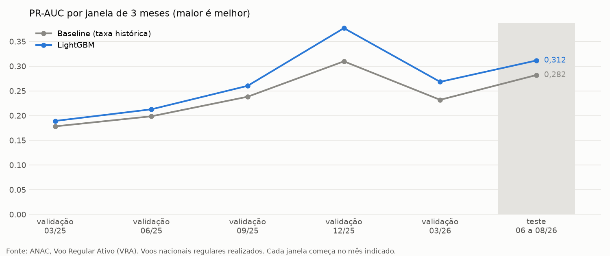
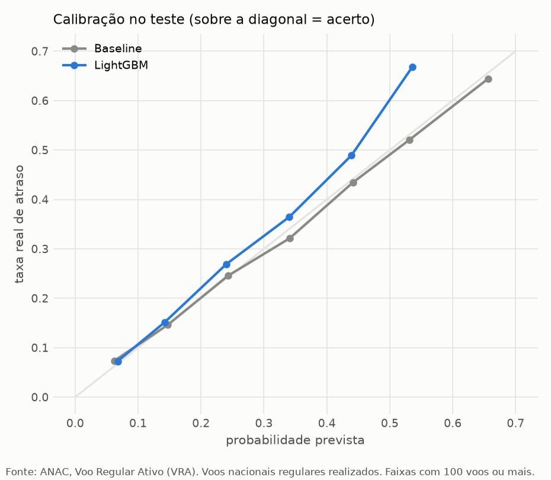
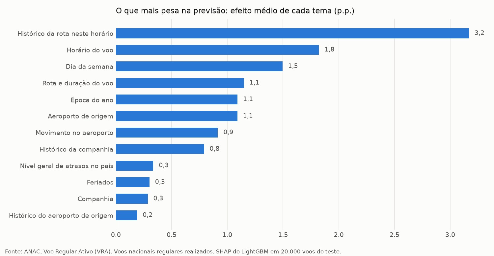

# Modelo: chance de um voo partir com mais de 15 minutos de atraso

Cartão do modelo (*model card*). Os números vêm de `models/metrics.json`,
`models/metadata.json`, `models/explicacao_global.json` e `models/uso_pratico.json`, gerados pelo
pipeline:

```powershell
python -m fdr.pipeline --stage validacao   # compara os modelos e trava as escolhas
python -m fdr.pipeline --stage train       # treino final e teste, usado uma única vez
python -m fdr.pipeline --stage explain     # SHAP por tema e gráficos
python -m fdr.pipeline --stage pratica     # regra de alerta no teste (precisão e cobertura)
```

## 1. A pergunta

Dado um voo programado (companhia, origem, destino, data e hora previstas), qual a probabilidade
de ele partir com **mais de 15 minutos de atraso** (critério A15)?

- **Para quem:** passageiros e curiosos que querem saber se um voo costuma atrasar e por quê.
- **Saída:** uma probabilidade (ex.: 18%) e os fatores que mais pesaram, em frases simples.

## 2. Dados

- **Fonte:** ANAC, Voo Regular Ativo (VRA), arquivos mensais de jan/2022 a ago/2026
  (`docs/dados.md`).
- **Base do modelo:** voos nacionais (tipo `N`), regulares (DI = `0`) e realizados, com partida
  prevista e real. São 3.478.254 voos, e 14,95% deles atrasaram mais de 15 minutos (ADR 002).
- **Treino final:** jan/2023 a abr/2026, 2.524.197 voos. O ano de 2022 serve só de histórico
  para as variáveis (ADR 003).
- **Teste:** jun a ago/2026, 196.159 voos, com 15,83% de atrasos. Foi usado uma única vez,
  depois de todas as escolhas travadas.

## 3. Variáveis

São 37 variáveis, todas conhecidas antes do voo e calculáveis para um voo futuro (ADR 003):

- **Calendário:** hora local, dia da semana, mês, feriado, véspera, dia seguinte e férias.
- **Voo:** companhia, origem, destino e distância.
- **Histórico (regra as-of):** taxa de atraso e número de voos da rota no mesmo horário, da
  companhia, do aeroporto de origem e do país, em 3 e 12 meses até o mês M − 2. Mais a
  sazonalidade: as mesmas taxas no mesmo mês do ano anterior.
- **Programação típica:** quantas partidas o aeroporto costuma ter naquele dia da semana e
  hora, e quantas partidas a companhia costuma ter antes desse horário.
- **Duração típica e folga da programação** da companhia na rota.

`tests/test_no_leakage.py` prova que nenhuma variável usa dados dos meses M − 1 e M.

## 4. Como o modelo foi escolhido

- **Validação no tempo:** 5 janelas de 3 meses, de mar/2025 a mai/2026. Em cada janela, o treino
  termina 2 meses antes, como na vida real, em que os dados saem com 2 meses de atraso.
- **Candidatos:**
  - baseline: taxa histórica da rota no horário;
  - regressão logística;
  - LightGBM.
- **Regra de 1 erro-padrão:** fica o modelo mais simples cuja PR-AUC média esteja a menos de 1
  erro-padrão da melhor (ADR 005).

| Modelo | PR-AUC média na validação |
| --- | --- |
| Baseline (rota x horário, 12 meses) | 0,231 |
| Regressão logística | 0,256 |
| **LightGBM** | **0,262** |

- **Escolha:** o LightGBM ganha da logística por 0,0059, mais que o erro-padrão da diferença
  (0,0043), e foi o escolhido.
- **Calibração:** a probabilidade crua teve Brier menor que as versões calibradas (isotônica e
  Platt), então o modelo não usa calibrador.
- **Configuração final:**
  - `num_leaves` = 127, `min_child_samples` = 100, `learning_rate` = 0,05;
  - 219 árvores, a mediana das 5 janelas.



## 5. Resultado no teste (jun a ago/2026)

Intervalos de 95% por bootstrap sorteando dias inteiros. O ganho sobre o baseline usa os mesmos
dias sorteados para os dois modelos (bootstrap pareado).

| Métrica | LightGBM (IC 95%) | Baseline | Ganho sobre o baseline (IC 95%) |
| --- | --- | --- | --- |
| PR-AUC | 0,312 (0,291 a 0,333) | 0,282 | +0,029 (+0,019 a +0,041) |
| ROC-AUC | 0,696 (0,685 a 0,705) | 0,674 | +0,022 (+0,015 a +0,029) |
| Brier (menor é melhor) | 0,1238 (0,1183 a 0,1301) | 0,1260 | −0,0021 (−0,0029 a −0,0014) |
| ECE (menor é melhor) | 1,24 p.p. (0,43 a 2,15) | 0,55 p.p. | +0,70 p.p. (−0,71 a +1,16) |

- **O modelo supera o baseline com folga em PR-AUC, ROC-AUC e Brier:** nenhum desses intervalos
  inclui o zero. No ECE, a diferença não é clara, porque o intervalo inclui o zero.
- **Na prática:** dos 10% de voos com maior risco previsto, 37,3% atrasaram, ou 2,35 vezes a taxa
  média. Com o baseline, foram 33,6%.
- **A PR-AUC do teste é maior que a da validação para os dois modelos** (o baseline foi de 0,231
  para 0,282). A comparação justa é entre os modelos no mesmo período, e não entre períodos.



## 6. Onde o modelo acerta e onde erra (teste)

| Segmento | Voos | PR-AUC do modelo | PR-AUC do baseline |
| --- | --- | --- | --- |
| LATAM (TAM) | 69.097 | 0,397 | 0,369 |
| Azul (AZU) | 65.365 | 0,198 | 0,178 |
| Gol (GLO) | 58.981 | 0,252 | 0,232 |
| Azul Conecta (ACN) | 2.648 | 0,088 | 0,090 |
| Guarulhos (SBGR) | 24.280 | 0,435 | 0,407 |
| Congonhas (SBSP) | 23.410 | 0,397 | 0,340 |
| Brasília (SBBR) | 14.232 | 0,169 | 0,136 |
| Madrugada (0h a 5h) | 19.418 | 0,146 | 0,112 |
| Noite (18h a 23h) | 45.987 | 0,394 | 0,347 |

- **O modelo ganha do baseline nas três maiores companhias**, nos 10 aeroportos com mais voos,
  nas quatro faixas de horário e nos três meses do teste.
- **Azul Conecta:** é a exceção. O modelo prevê 18,2% de atraso, mas a taxa real foi de 7,3%.
- **Risco alto:** o modelo subestima. Na faixa de 50% a 60% previstos, atrasaram 66,8% dos voos
  (695 voos).
- **No total:** a taxa prevista ficou em 14,6%, contra 15,8% de taxa real.

A tabela completa está em `models/metrics.json`, na seção `modelo_final.teste.segmentos`.

### Na prática: uma regra de alerta

Uma forma simples de usar o modelo é avisar os passageiros dos voos com maior risco previsto.
A tabela mostra, no teste (196.159 voos, 31.058 atrasos), a **precisão** (dos voos avisados,
quantos atrasaram) e a **cobertura** (dos atrasos, quantos foram avisados):

| Voos avisados | Precisão do modelo | Precisão do baseline | Cobertura do modelo | Cobertura do baseline |
| --- | --- | --- | --- | --- |
| 5% | 42,2% | 38,8% | 13,3% | 12,3% |
| 10% | 37,3% | 33,6% | 23,5% | 21,2% |
| 20% | 31,7% | 29,3% | 40,1% | 37,1% |
| 30% | 28,1% | 26,5% | 53,2% | 50,1% |

- **Nas quatro frações da tabela, o modelo pega mais atrasos que o baseline**, mas a diferença é
  pequena: de 1,0 a 3,1 pontos percentuais de cobertura.
- **Há um preço:** avisando 10% dos voos, 62,7% dos avisos seriam alarme falso, e 76,5% dos
  atrasos ficariam sem aviso.
- **Uso adequado:** priorizar (por exemplo, quem escolhe um horário ou uma conexão), e não
  garantir nada sobre um voo.

A curva completa (de 1% a 50% dos voos) e as regras por limiar de probabilidade estão em
`models/uso_pratico.json`, gerado pela etapa `pratica`, que confere que as previsões refeitas
reproduzem o PR-AUC do `models/metrics.json`.

## 7. O que mais pesa na previsão

O SHAP vem do próprio LightGBM (TreeSHAP) e foi somado por tema. O gráfico mostra o efeito médio
de cada tema sobre a probabilidade em 20.000 voos do teste.



- **O que mais pesa:**
  - o histórico da rota naquele horário: 3,2 p.p. em média;
  - a hora do voo: 1,8 p.p.;
  - o dia da semana: 1,5 p.p.
- **Exemplo de explicação de um voo:** LATAM, de Guarulhos para o Galeão às 23h numa
  quinta-feira, com 59% de chance de atraso. Os fatores foram o histórico da rota naquele horário
  (+20,0 p.p.), o movimento no aeroporto (+14,0 p.p.), o dia da semana (+5,5 p.p.) e a época do
  ano (−1,2 p.p.).

## 8. Limitações

- **Sem clima.** Chuva e tempestades são uma das maiores causas de atraso, e o VRA não as traz.
- **Sem a rotação da aeronave.** O VRA não diz qual avião faz cada voo, então o atraso do voo
  anterior do mesmo avião não entra. A posição do voo no dia da companhia é só uma aproximação.
- **Programação típica, e não a real.** Para um voo futuro, o modelo usa quantas partidas o
  aeroporto costuma ter, e não a programação exata do dia.
- **Dados com 2 meses de atraso.** As variáveis usam o histórico até 2 meses antes. Mudanças
  recentes (uma companhia nova, uma obra no aeroporto) demoram a aparecer.
- **Cancelados ficam de fora** (ADR 002). A probabilidade é de atraso, e não de cancelamento.
- **Probabilidades altas são subestimadas**, e há mais erro em companhias pequenas (seção 6).
- **A ANAC regera a série inteira a cada publicação.** A avaliação usa a versão atual dos meses
  antigos (ADR 003).

## 9. O que o modelo NÃO deve ser usado para fazer

- Garantir que um voo específico vai ou não atrasar: é uma probabilidade, e 15% dos voos
  atrasam.
- Ranquear a qualidade das companhias ou dos aeroportos: as diferenças misturam rotas, horários e
  aeroportos diferentes.
- Tomar decisões operacionais (escala, manutenção) ou basear pedidos de indenização.
- Substituir as informações oficiais da companhia e do aeroporto no dia do voo.

## 10. Arquivos

| Arquivo | O que guarda |
| --- | --- |
| `models/model.txt` | o LightGBM no formato nativo (texto, sem pickle) |
| `models/metadata.json` | datas, variáveis, hiperparâmetros, categorias, versões e hash dos dados |
| `models/metrics.json` | baseline, validação, escolha, calibração, teste e segmentos |
| `models/reference_profile.json` | distribuição das variáveis no treino (para o PSI na Fase 4) |
| `models/explicacao_global.json` | SHAP médio por tema e por variável no teste |
| `models/uso_pratico.json` | precisão e cobertura de uma regra de alerta no teste, modelo e baseline |
